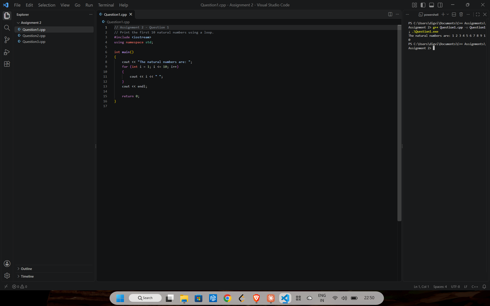
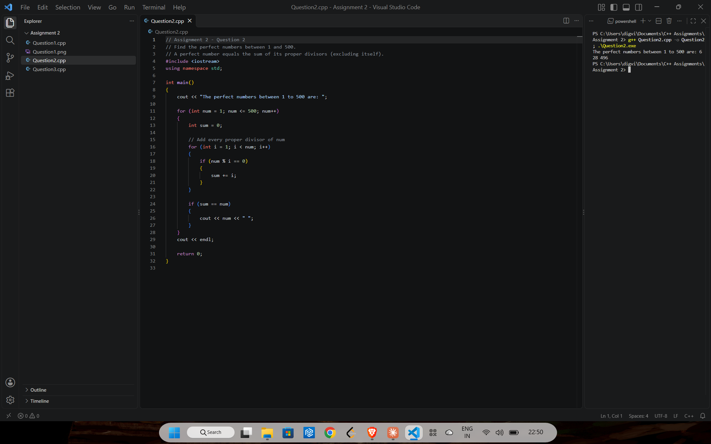
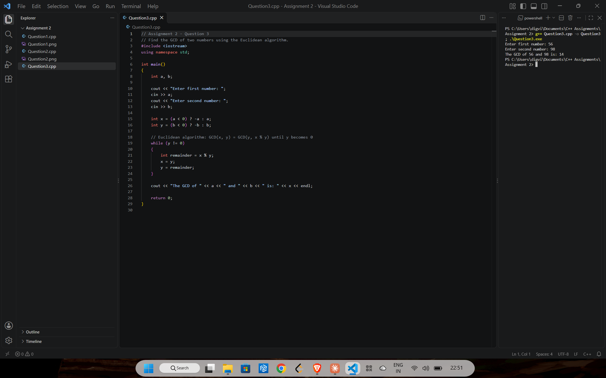

# Assignment 2: Loops

[← All assignments](../README.md)

| # | Question | Code |
|---|---|---|
| 1 | Print the first 10 natural numbers using a loop | [`Question1.cpp`](Question1.cpp) |
| 2 | Find the perfect numbers between 1 and 500 | [`Question2.cpp`](Question2.cpp) |
| 3 | Find the GCD of two numbers with the Euclidean algorithm | [`Question3.cpp`](Question3.cpp) |

## Question 1: First 10 natural numbers

## Question 2: Perfect numbers up to 500

A perfect number equals the sum of its proper divisors, like 6 = 1 + 2 + 3. Between 1 and 500 there are three: 6, 28 and 496.

## Question 3: GCD with the Euclidean algorithm

Repeats `GCD(x, y) = GCD(y, x % y)` until `y` is 0. Negative inputs work too.

