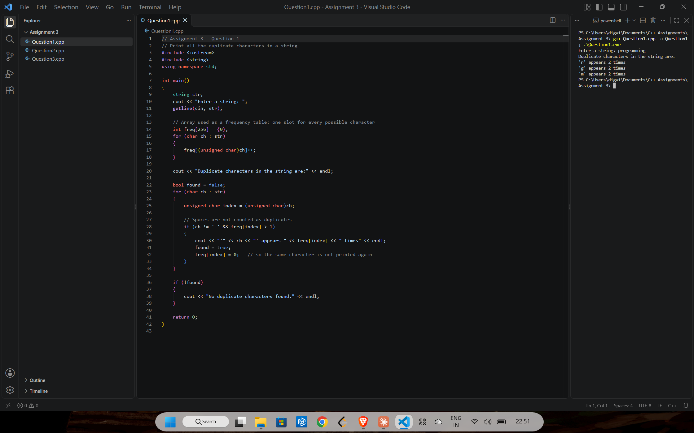
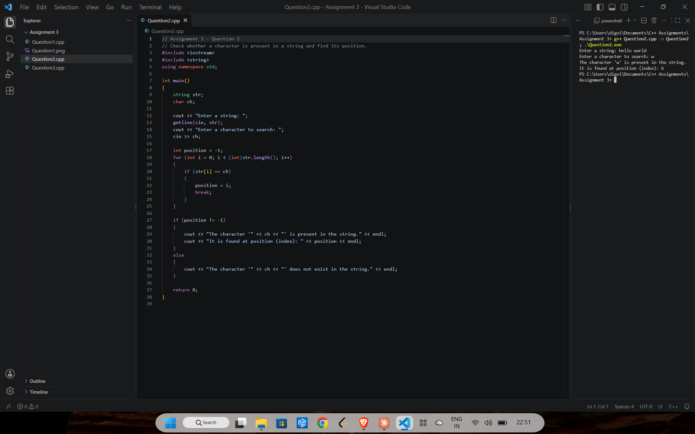
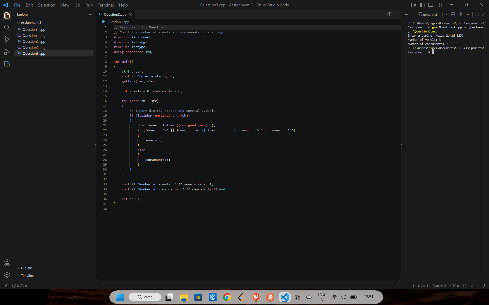

# Assignment 3: Strings

[← All assignments](../README.md)

| # | Question | Code |
|---|---|---|
| 1 | Print all the duplicate characters in a string | [`Question1.cpp`](Question1.cpp) |
| 2 | Check whether a character is in a string and find its position | [`Question2.cpp`](Question2.cpp) |
| 3 | Count the vowels and consonants in a string | [`Question3.cpp`](Question3.cpp) |

## Question 1: Duplicate characters

Builds a 256-slot frequency table, then prints each repeated character once with its count. Spaces are skipped.

## Question 2: Find a character

## Question 3: Vowels and consonants

Only letters are counted; digits, spaces and symbols are ignored.

