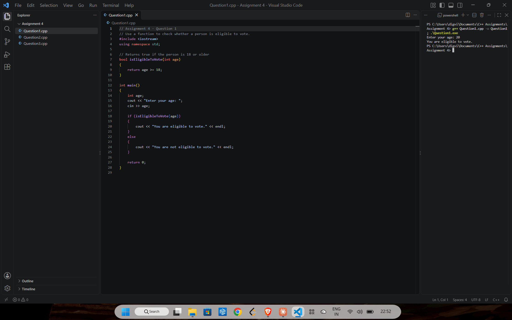
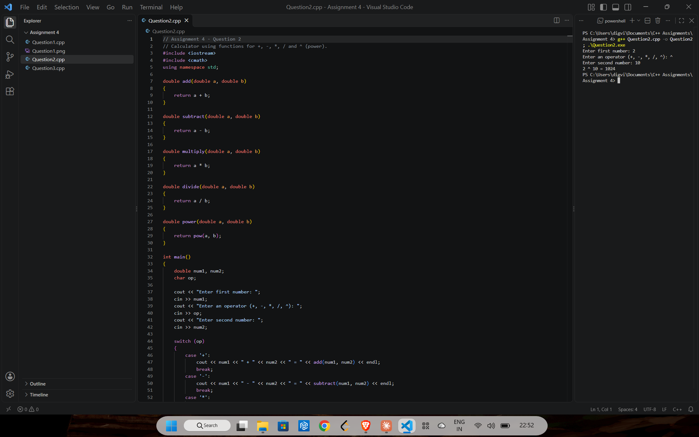
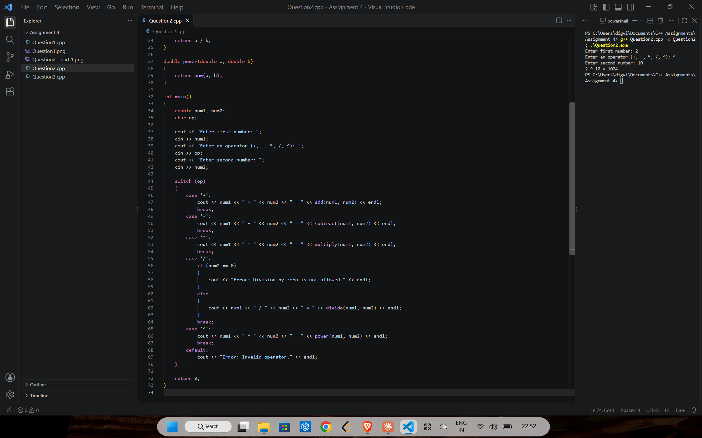
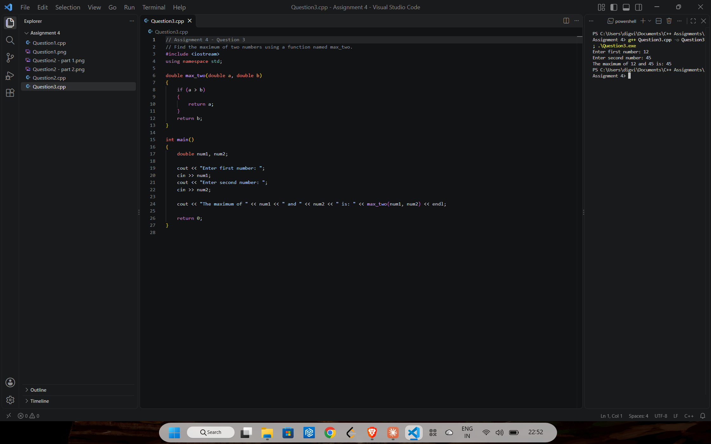

# Assignment 4: Functions

[← All assignments](../README.md)

| # | Question | Code |
|---|---|---|
| 1 | Use a function to check whether a person can vote | [`Question1.cpp`](Question1.cpp) |
| 2 | Calculator with a function for each of +, −, ×, ÷ and ^ | [`Question2.cpp`](Question2.cpp) |
| 3 | Find the larger of two numbers with a function named `max_two` | [`Question3.cpp`](Question3.cpp) |

## Question 1: Voting eligibility

## Question 2: Calculator

Each operation is its own function. Dividing by zero and unknown operators print an error instead of crashing.

## Question 3: `max_two`

