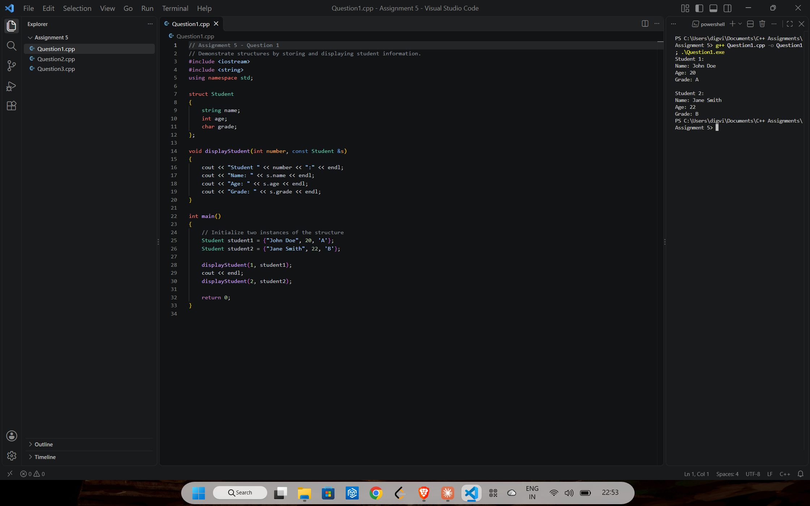
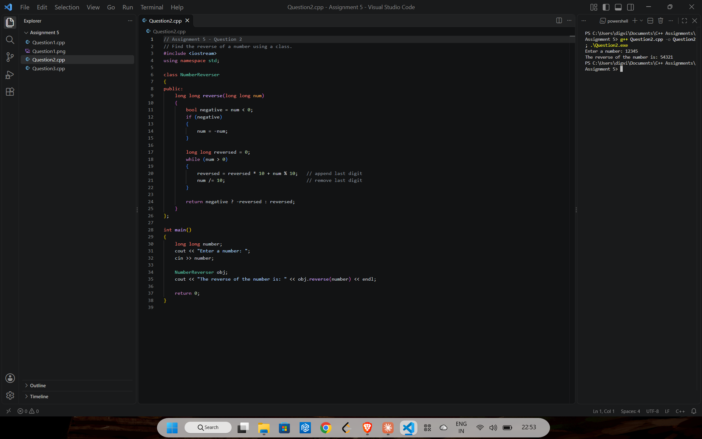
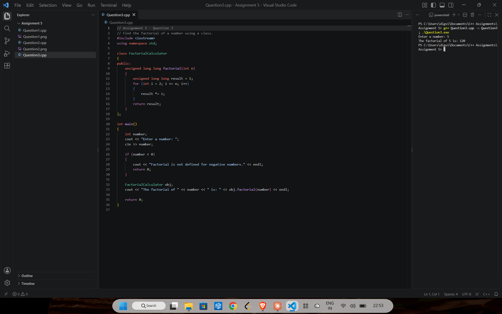

# Assignment 5: Structs and classes

[← All assignments](../README.md)

| # | Question | Code |
|---|---|---|
| 1 | Store and display student details with a structure | [`Question1.cpp`](Question1.cpp) |
| 2 | Reverse a number using a class | [`Question2.cpp`](Question2.cpp) |
| 3 | Find the factorial of a number using a class | [`Question3.cpp`](Question3.cpp) |

## Question 1: `Student` structure

## Question 2: Reverse a number

Handles negative numbers too: `-1234` becomes `-4321`.

## Question 3: Factorial

Uses `unsigned long long`, which holds factorials up to 20!.

