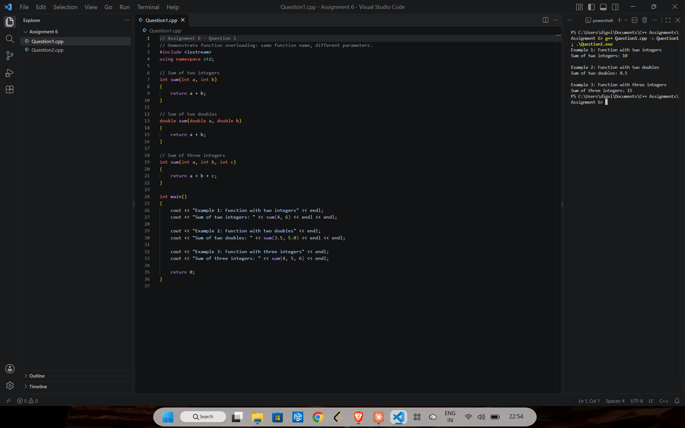
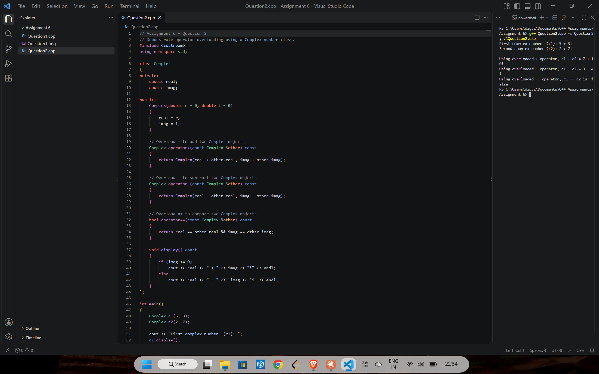
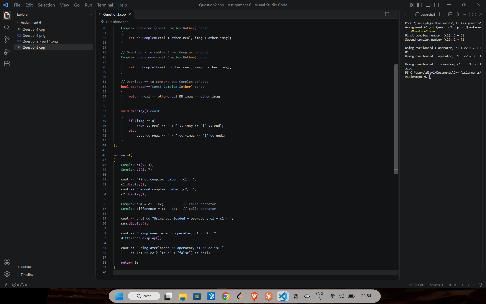

# Assignment 6: Overloading

[← All assignments](../README.md)

| # | Question | Code |
|---|---|---|
| 1 | Show function overloading: one `sum()` name, three parameter lists | [`Question1.cpp`](Question1.cpp) |
| 2 | Show operator overloading with `+`, `-` and `==` on a `Complex` class | [`Question2.cpp`](Question2.cpp) |

## Question 1: Function overloading

The compiler picks `sum(int, int)`, `sum(double, double)` or `sum(int, int, int)` from the arguments.

## Question 2: Operator overloading

