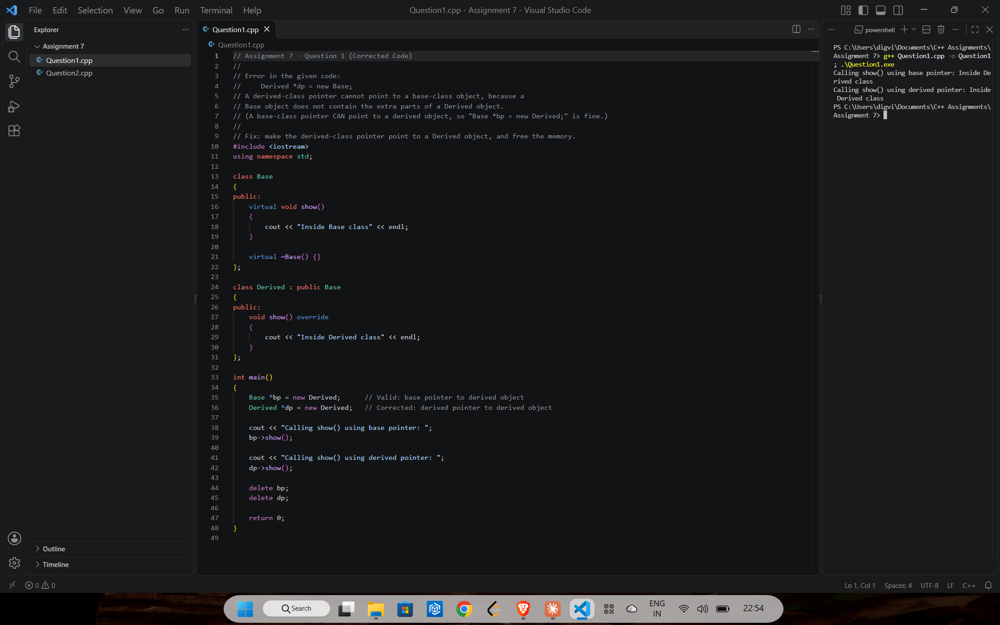
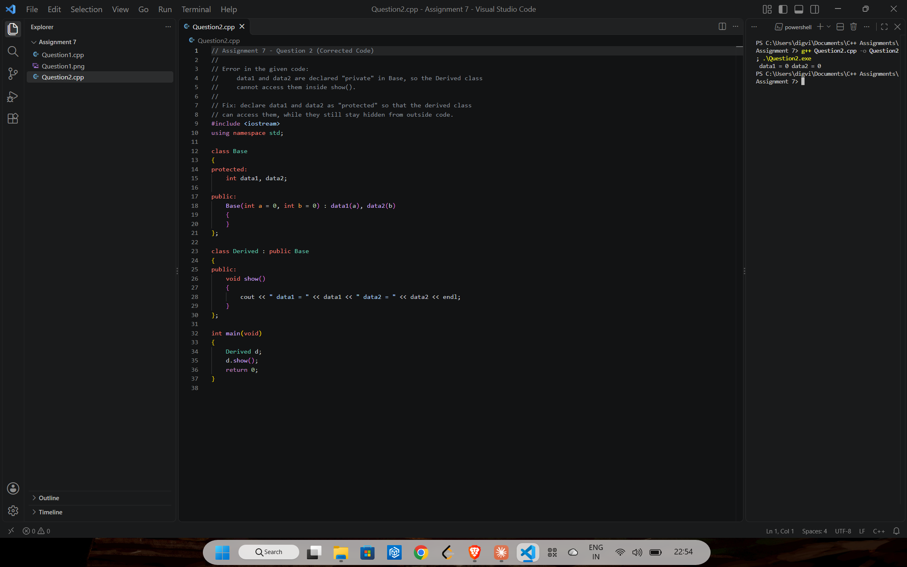

# Assignment 7: Inheritance

[← All assignments](../README.md)

Both questions give a broken program to find the error in and fix. The comment at the top of each file explains the bug.

| # | Question | Code |
|---|---|---|
| 1 | Fix a derived-class pointer that points at a base-class object | [`Question1.cpp`](Question1.cpp) |
| 2 | Fix a derived class that can't reach its base class's members | [`Question2.cpp`](Question2.cpp) |

## Question 1: Derived pointer to a base object

`Derived *dp = new Base;` doesn't compile: a `Base` object lacks the parts a `Derived` has. The fix points `dp` at a `Derived` and frees both objects.

## Question 2: `private` vs `protected`

`data1` and `data2` were `private` in `Base`, so `Derived::show()` couldn't read them. Making them `protected` opens them to derived classes while still hiding them from outside code.

