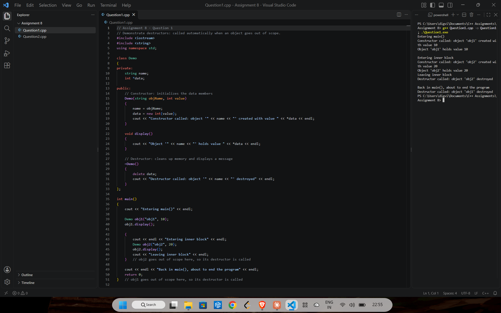
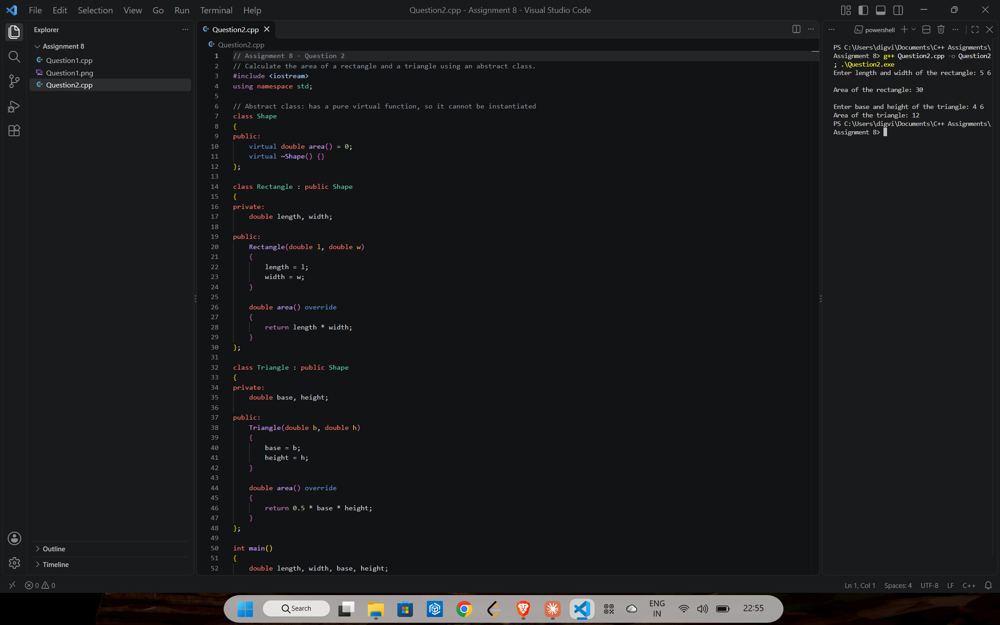
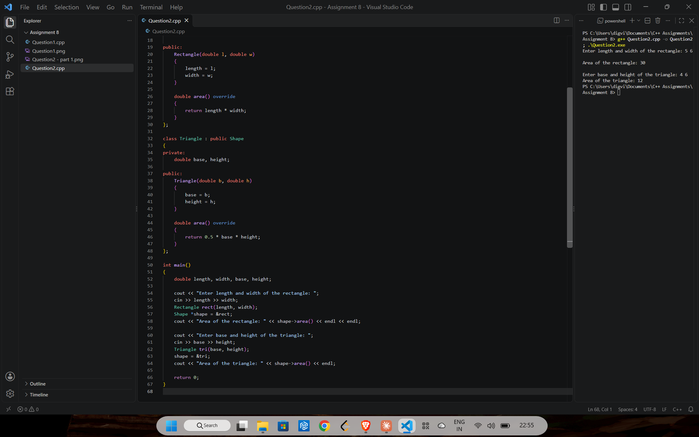

# Assignment 8: Destructors and abstract classes

[← All assignments](../README.md)

| # | Question | Code |
|---|---|---|
| 1 | Show that a destructor runs when an object goes out of scope | [`Question1.cpp`](Question1.cpp) |
| 2 | Find the area of a rectangle and a triangle with an abstract class | [`Question2.cpp`](Question2.cpp) |

## Question 1: Destructors

`obj2` lives in an inner block, so its destructor runs as soon as that block ends. `obj1` is destroyed when `main()` returns.

## Question 2: Abstract `Shape` class

`Shape` has a pure virtual `area()`, so it can't be created on its own. `Rectangle` and `Triangle` each give their own `area()`, called through a `Shape*`.

