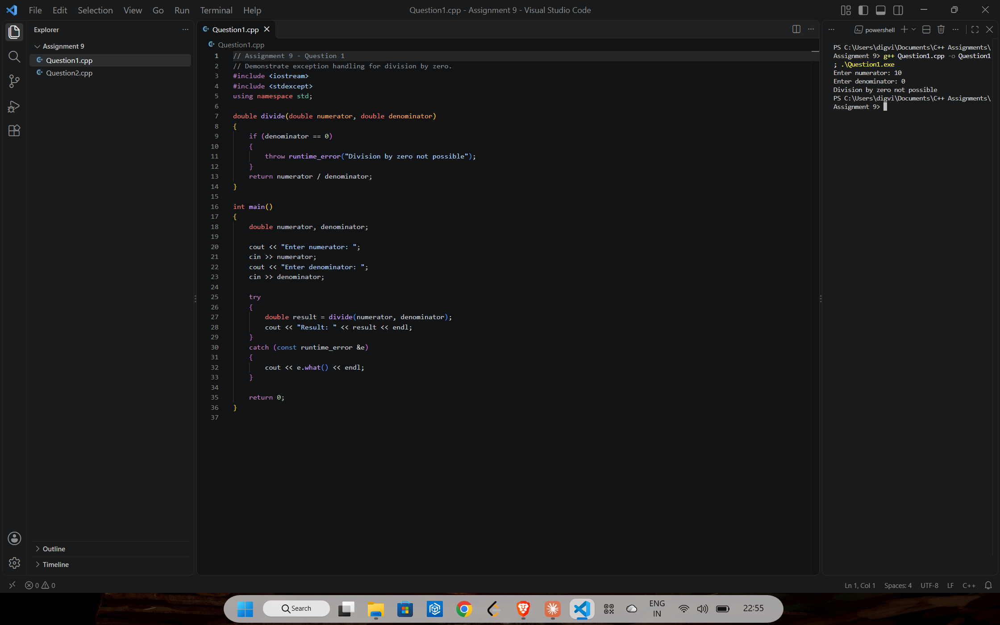
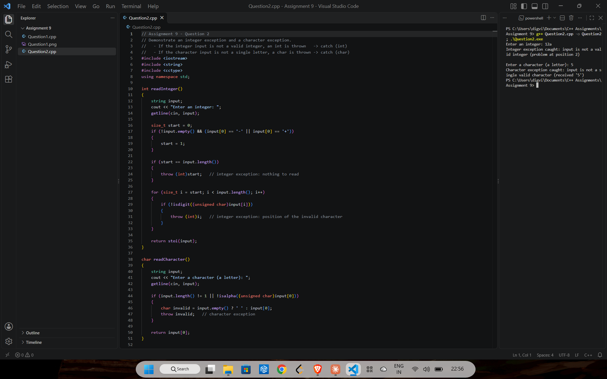
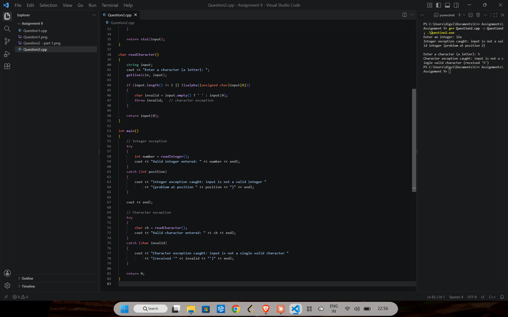

# Assignment 9: Exception handling

[← All assignments](../README.md)

| # | Question | Code |
|---|---|---|
| 1 | Handle division by zero with an exception | [`Question1.cpp`](Question1.cpp) |
| 2 | Show an integer exception and a character exception | [`Question2.cpp`](Question2.cpp) |

## Question 1: Division by zero

`divide()` throws a `runtime_error` when the denominator is 0, and `main()` catches it and prints the message.

## Question 2: `int` and `char` exceptions

An invalid integer throws an `int` (the position of the bad character). Anything other than a single letter throws a `char`.

