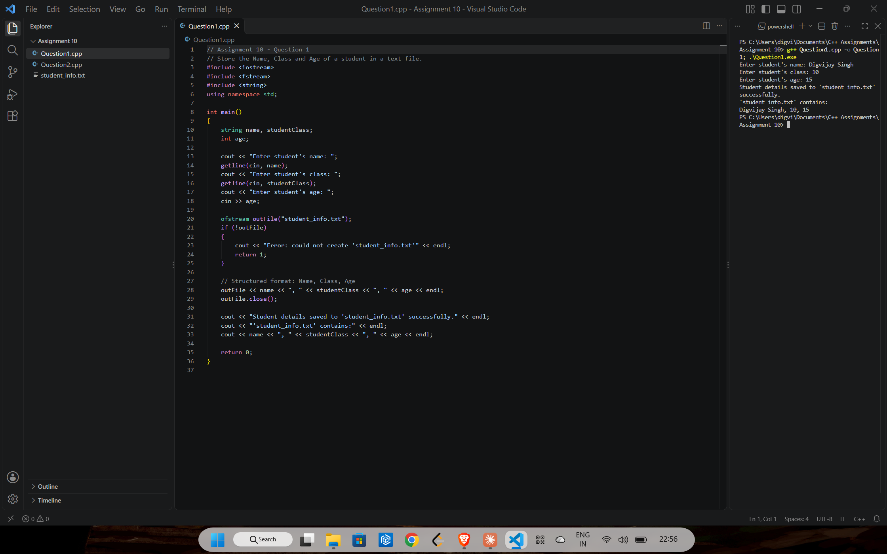
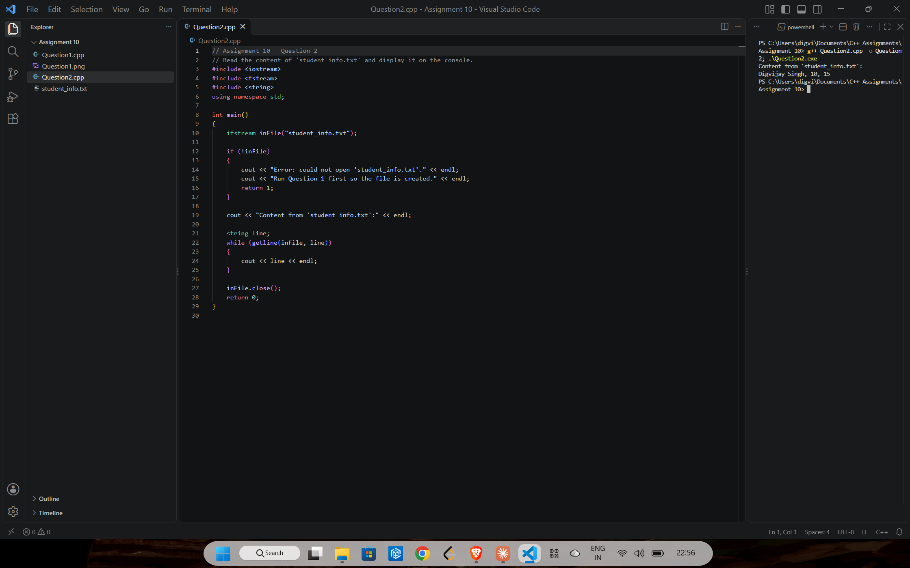

# Assignment 10: File handling

[← All assignments](../README.md)

| # | Question | Code |
|---|---|---|
| 1 | Save a student's name, class and age to a text file | [`Question1.cpp`](Question1.cpp) |
| 2 | Read that file back and print it | [`Question2.cpp`](Question2.cpp) |

Question 1 writes [`student_info.txt`](student_info.txt) and Question 2 reads it, so run them in that order.

## Question 1: Write to a file

## Question 2: Read from a file

