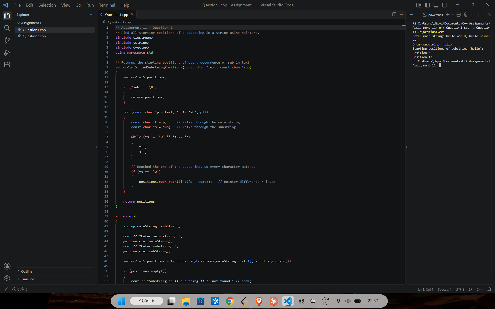
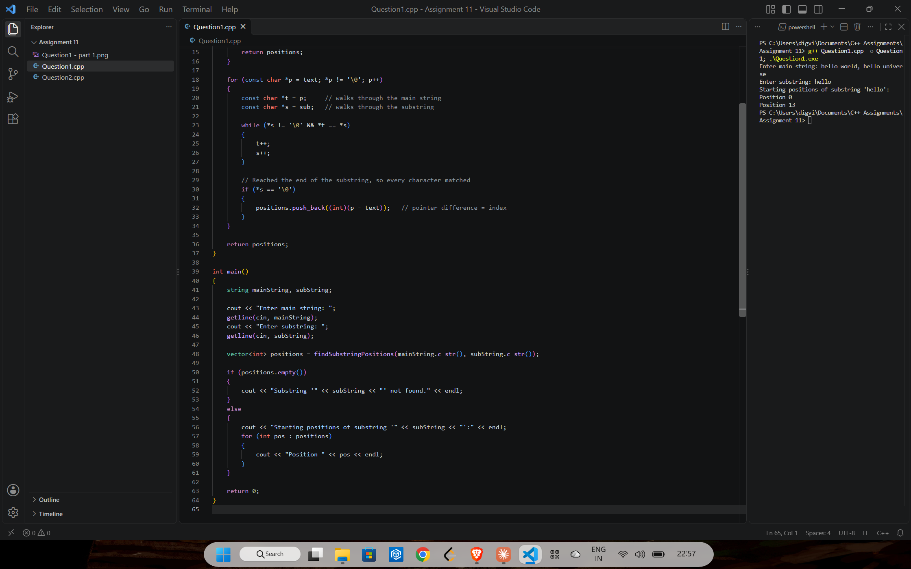
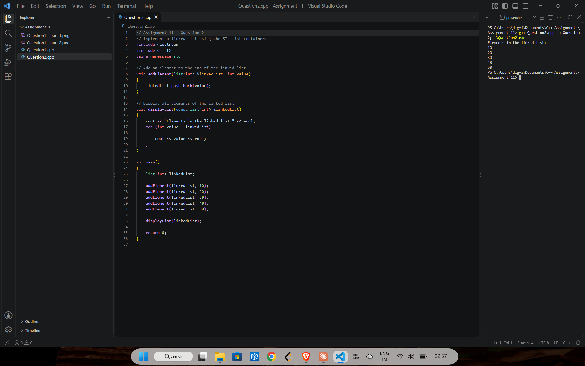

# Assignment 11: Pointers and the STL

[← All assignments](../README.md)

| # | Question | Code |
|---|---|---|
| 1 | Find every starting position of a substring using pointers | [`Question1.cpp`](Question1.cpp) |
| 2 | Build a linked list with the STL `list` container | [`Question2.cpp`](Question2.cpp) |

## Question 1: Substring positions with pointers

Two pointers walk the main string and the substring side by side. Subtracting pointers gives the index, and overlapping matches count: `aba` in `abababa` is found at 0, 2 and 4.

## Question 2: Linked list with `std::list`

